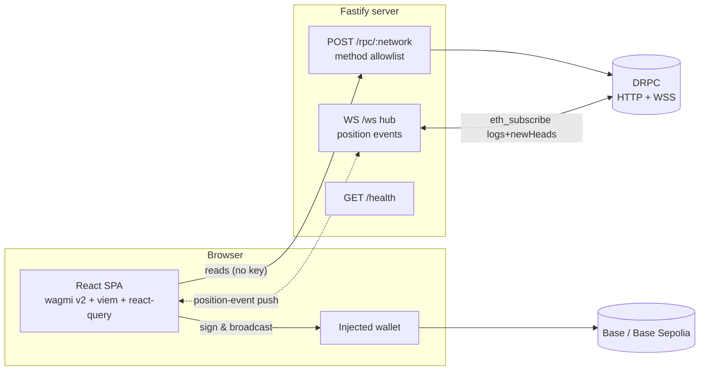

# Aave V3 Position Builder

Open a collateralized borrow position on Aave V3 (Base / Base Sepolia) in one transaction, sized by a target health factor, with eMode capital-efficiency detection. Reads go through a key-guarding RPC proxy; a WebSocket hub pushes position events so the UI updates within seconds of confirmation.

Quickstart: `cp .env.example .env` (set `DRPC_KEY`), `pnpm install`, `pnpm dev` — then open http://localhost:5173.

Design tradeoffs live in [docs/DECISIONS.md](docs/DECISIONS.md).

## Architecture



The DRPC key exists only inside the server process (`apps/server/src/rpc/upstream.ts`). The browser
never talks to DRPC; transaction broadcast goes through the wallet's own provider.

## Setup (clean clone)

```bash
cp .env.example .env        # then edit: set DRPC_KEY=<your dRPC key>
pnpm install
pnpm dev                    # server on :8787 + web on :5173
```

Open http://localhost:5173. Requires Node >= 22, pnpm 10, and an injected wallet
(MetaMask/Rabby) in the browser.

## Getting test tokens (Base Sepolia)

1. Gas: get Base Sepolia ETH from the [Alchemy faucet](https://www.alchemy.com/faucets/base-sepolia)
   (or [Coinbase faucet](https://portal.cdp.coinbase.com/products/faucet)).
2. WETH is NOT faucet-mintable — it is wrapped ETH. Wrap by calling `deposit()` on
   `0x4200000000000000000000000000000000000006` with value attached (exact command in
   [docs/VERIFICATION.md](docs/VERIFICATION.md), or send ETH to the contract from your wallet).
3. Aave testnet tokens (USDC, cbETH, …) are mintable via the unpermissioned Aave faucet
   contract — `mint(token, to, amount)`; addresses and `cast` commands in
   [docs/VERIFICATION.md](docs/VERIFICATION.md). (One-click mint in the UI is a planned P1.)

## Tests

```bash
pnpm test        # all workspaces (vitest) — runs offline against committed fixtures
pnpm typecheck   # tsc across all workspaces
```

To refresh the captured Base Sepolia fixture (needs the server running):
`pnpm --filter @app/web exec tsx scripts/capture-fixtures.mjs`

Full manual acceptance run: [docs/VERIFICATION.md](docs/VERIFICATION.md).
